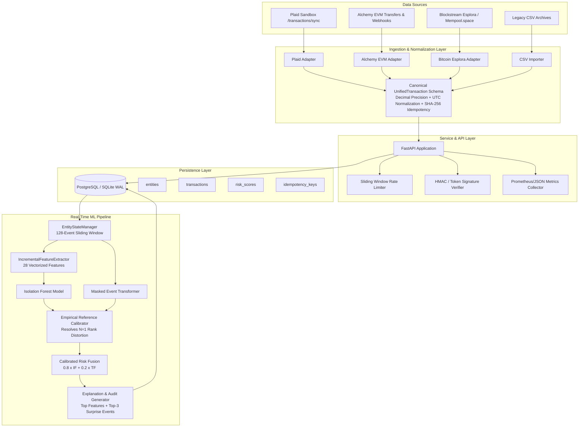
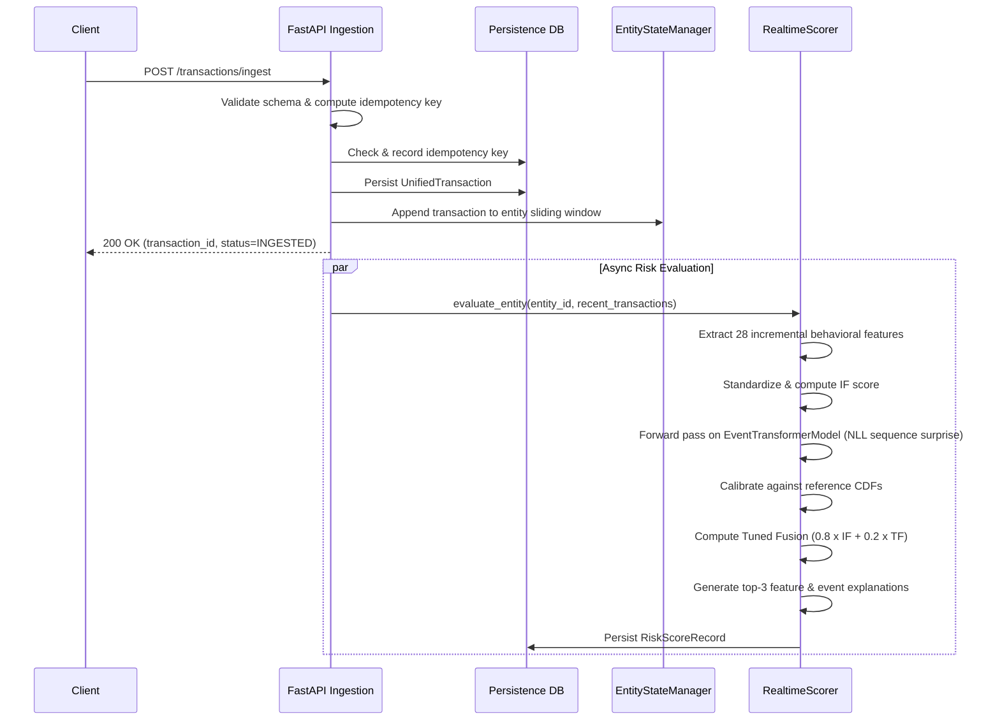
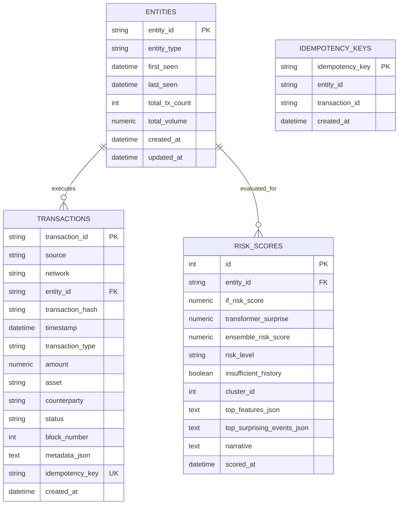

# DeCrypt: System Architecture Specification

## 1. Executive Overview

**DeCrypt** is an end-to-end, multi-source financial and cryptocurrency transaction anomaly detection platform. Initially conceived as a research framework for batch forensic analysis on Bitcoin transaction records, DeCrypt has evolved into an enterprise-grade hybrid architecture supporting both **continuous real-time streaming ingestion** and **offline forensic batch processing**.

The platform ingests heterogeneous transaction streams from:
1. **Traditional Banking (Plaid Sandbox)**: Synchronized fiat account debits, credits, and modification webhooks.
2. **EVM-Compatible Blockchains (Alchemy)**: Native ETH and ERC-20 smart contract token transfers across Ethereum, Arbitrum, Optimism, Polygon, and Base.
3. **UTXO Blockchains (Bitcoin Esplora / Mempool.space)**: Wallet-level transaction decomposition from raw multi-input/multi-output UTXO blocks and unconfirmed mempools.
4. **Legacy Batch Archives**: Five-column historical CSV transaction archives (`address_id`, `timestamp`, `transaction_type`, `amount`, `is_fraud`).

The processing core pairs a **28-dimensional vectorized behavioral profiler** (Isolation Forest) with a **BERT-style Masked Event Transformer** (`EventTransformerModel`), delivering calibrated ensemble anomaly risk scores ($0.0 - 100.0$) alongside deterministic explanations (top anomalous features and top-3 surprising sequence events).

---

## 2. High-Level Architecture

---

## 3. Unified Domain & Canonical Schema

### 3.1 Data Integrity & Type Safety
Financial anomaly detection fails when arbitrary precision loss or ambiguous transaction directions corrupt behavioral profiling. DeCrypt enforces strict invariants via Pydantic v2:

- **Arbitrary Precision Decimal Representation**: Amounts are stored and computed using Python's `decimal.Decimal` (or fixed-base integer Satoshis/Wei). IEEE 754 floating-point drift is strictly prohibited.
- **Strict UTC Normalization**: All incoming timestamps (ISO-8601 strings, UNIX epoch offsets, or legacy formatted datetimes) are parsed and converted to timezone-aware UTC (`datetime.timezone.utc`).
- **Asset Separation**: Transactions retain their native asset identity (e.g., `USD`, `BTC`, `ETH`, `USDC`). Cross-asset values are never aggregated without explicit FX conversion.
- **Deterministic Idempotency**: Duplicate transaction submissions are intercepted using a deterministic SHA-256 hash:
  $$\text{hash} = \text{SHA256}(\text{source} \parallel \text{network} \parallel \text{tx\_hash} \parallel \text{entity\_id} \parallel \text{type} \parallel \text{amount} \parallel \text{timestamp})$$

### 3.2 Canonical Transaction Structure (`UnifiedTransaction`)

| Attribute | Type | Description |
| :--- | :--- | :--- |
| `transaction_id` | `str` | Globally unique internal transaction identifier. |
| `source` | `TransactionSource` | `BANKING_PLAID`, `CRYPTO_ETHEREUM`, `CRYPTO_BITCOIN`, `CSV_IMPORT`, `INTERNAL`. |
| `network` | `NetworkType` | `FIAT_BANKING`, `ETHEREUM_MAINNET`, `ARBITRUM`, `OPTIMISM`, `POLYGON`, `BASE`, `BITCOIN`. |
| `entity_id` | `str` | Account number or blockchain wallet address under observation. |
| `transaction_hash` | `str` | Blockchain hash, bank transaction reference ID, or synthetic identifier. |
| `timestamp` | `datetime` | Timezone-aware UTC timestamp. |
| `transaction_type` | `TransactionType` | `DEPOSIT` (inflow to entity), `WITHDRAWAL` (outflow from entity), `TRANSFER`, `FEE`. |
| `amount` | `Decimal` | Non-negative transaction quantity in native asset units. |
| `asset` | `str` | Asset symbol (e.g., `USD`, `EUR`, `BTC`, `ETH`, `USDC`). |
| `counterparty` | `Optional[str]` | Sender/recipient address, merchant name, or external entity ID. |
| `status` | `TransactionStatus` | `PENDING`, `CONFIRMED`, `POSTED`, `REVERSED`, `REMOVED`. |
| `block_number` | `Optional[int]` | Ledger block height (for blockchain transactions). |
| `metadata` | `Dict[str, Any]` | Provider-specific payloads (e.g., gas price, category, mempool fee). |

### 3.3 UTXO Decomposition vs. Account-Based Semantics
A fundamental design flaw in naive cryptocurrency analysis tools is treating multi-input, multi-output Bitcoin transactions as a single entity withdrawal or deposit. DeCrypt resolves this in `decrypt.providers.bitcoin_adapter`:
1. Inspects all transaction `inputs` to aggregate Satoshis spent by `entity_id`.
2. Inspects all transaction `outputs` to aggregate Satoshis received by `entity_id`.
3. If $\text{spent} > \text{received}$, the transaction is recorded as a net `WITHDRAWAL` of $(\text{spent} - \text{received})$ Satoshis.
4. If $\text{received} > \text{spent}$, the transaction is recorded as a net `DEPOSIT` of $(\text{received} - \text{spent})$ Satoshis.
5. Unrelated UTXO outputs belonging to change addresses or third parties are excluded from the entity's direct flow.

---

## 4. Multi-Source Ingestion Architecture

### 4.1 Plaid Sandbox Banking Integration (`PlaidAdapter`)
- **Authentication**: Exchanges `PLAID_CLIENT_ID` and `PLAID_SECRET` against the sandbox API endpoint (`https://sandbox.plaid.com`).
- **Cursor-Based Sync**: Interacts with `/transactions/sync` using persistent pagination cursors. Handles three event streams:
  - `added`: Creates new confirmed/posted `UnifiedTransaction` records.
  - `modified`: Updates pending transactions to posted status or revises amounts.
  - `removed`: Transitions existing transactions to `REMOVED` status without destroying audit trails.
- **Direction Inversion**: In Plaid semantics, a positive amount denotes a debit (money leaving the account). The adapter automatically converts positive Plaid amounts to `TransactionType.WITHDRAWAL` and negative amounts to `TransactionType.DEPOSIT`.
- **Webhook Verification**: Validates incoming `SYNC_UPDATES_AVAILABLE` webhooks via verification headers.

### 4.2 Alchemy EVM Integration (`AlchemyAdapter`)
- **Transfers API**: Calls `alchemy_getAssetTransfers` via JSON-RPC across Ethereum, Arbitrum, Optimism, Polygon, and Base.
- **Dual Flow Extraction**:
  - Outgoing transfers (`fromAddress == entity_id`): Formatted as `WITHDRAWAL`.
  - Incoming transfers (`toAddress == entity_id`): Formatted as `DEPOSIT`.
- **Token Handling**: Decodes raw hex values using contract decimal precision for ERC-20 tokens, mapping contract addresses to asset symbols (`USDC`, `USDT`, `DAI`, `WETH`).
- **Webhook Signature Verification**: Computes HMAC-SHA256 signatures over raw incoming webhook payloads using `X-Alchemy-Signature` and the configured signing secret.

### 4.3 Bitcoin Esplora / Mempool.space Integration (`BitcoinAdapter`)
- **Dual API Support**: Interfaces with Blockstream Esplora (`https://blockstream.info/api`) or self-hosted Mempool.space instances.
- **History & Mempool Streaming**:
  - `/address/:address/txs`: Fetches confirmed on-chain transaction history.
  - `/address/:address/txs/mempool`: Retrieves unconfirmed pending transactions with zero confirmations.
  - `/tx/:txid`: Retrieves individual transaction input/output UTXO graphs.
- **Conversion**: Enforces 1 BTC = $10^8$ Satoshis fixed precision conversion via `Decimal`.

---

## 5. Real-Time ML & Incremental Scoring Pipeline

### 5.1 Resolving the $N=1$ Rank Distortion Bug
In batch offline processing, Isolation Forest decision function scores and Transformer negative log-likelihood (NLL) surprise values are converted into percentiles by sorting the entire dataset ($N$ entities):
$$\text{rank}(x) = \frac{\text{count}(s \le x)}{N} \times 100$$

When evaluating a single entity in a real-time streaming endpoint, computing percentiles over a single entity ($N=1$) always degenerates to $0.0$ or $100.0$, rendering rank fusion impossible.

DeCrypt solves this via **Empirical Reference CDF Calibration**:
1. During batch model training or system startup, baseline reference distributions for Isolation Forest anomaly scores and Transformer sequence NLLs are computed and serialized.
2. The `RealtimeScorer` uses `scipy.stats.percentileofscore` over these frozen reference distributions:
   $$\text{rank}_{\text{IF}}(s) = \text{percentileofscore}(\mathcal{D}_{\text{IF\_ref}}, s, \text{kind}='weak')$$
   $$\text{rank}_{\text{TF}}(s) = \text{percentileofscore}(\mathcal{D}_{\text{TF\_ref}}, s, \text{kind}='weak')$$
3. Calibrated ranks are bounded strictly within $[0.0, 100.0]$ and remain statistically consistent with batch results.

### 5.2 Incremental Feature Extraction (28 Features)
The `IncrementalFeatureExtractor` maintains an in-memory sliding window of the entity's last 128 transactions (`EntityStateManager`), computing the exact 28 features required by the Isolation Forest without requiring full-dataset SQL table scans. Full mathematical parity between batch and incremental extraction is verified across 20 real entities (20 entities × 28 features = 560 comparisons actually made with 0 mismatches in `tests/test_feature_parity.py`):

1. `total_transactions`: Event count in history window.
2. `total_volume`: Sum of absolute transaction amounts ($\sum |a_i|$).
3. `net_flow`: Sum of signed transactions ($\sum a_i$).
4. `avg_transaction_size`: Mean absolute transaction amount.
5. `max_transaction`: Maximum absolute transaction amount.
6. `min_transaction`: Minimum absolute transaction amount.
7. `transaction_variance`: Variance of absolute transaction amounts.
8. `total_deposited`: Sum of positive inflow amounts.
9. `total_withdrawn`: Sum of positive outflow amounts.
10. `n_deposits`: Inflow transaction count.
11. `n_withdrawals`: Outflow transaction count.
12. `deposit_withdraw_ratio`: $\frac{n_{\text{deposits}}}{n_{\text{withdrawals}} + 1}$.
13. `pass_through_ratio`: $\min(\text{inflow}, \text{outflow}) / \max(\text{inflow}, \text{outflow})$.
14. `activity_period_days`: Total active span in days between first and last transaction.
15. `activity_centroid`: Normalized temporal centroid (mean offset from first transaction divided by span).
16. `burstiness`: Goh-Barabási coefficient $B = \frac{\sigma_{\Delta t} - \mu_{\Delta t}}{\sigma_{\Delta t} + \mu_{\Delta t}}$.
17. `avg_time_between_txs`: Mean inter-event time ($\Delta t$) in seconds.
18. `tx_time_variance`: Variance of inter-event time ($\Delta t$).
19. `cv_inter_event_time`: Coefficient of variation of inter-event gaps ($\frac{\sigma_{\Delta t}}{\mu_{\Delta t}}$).
20. `lag1_autocorr_inter_event_time`: Lag-1 autocorrelation of $\Delta t$.
21. `modal_amount_share`: Fraction of transactions sharing the modal amount ($\frac{\text{count}(\text{mode})}{\text{total txs}}$).
22. `amount_entropy`: Shannon entropy of binned transaction amounts.
23. `large_transaction_ratio`: Fraction of transactions exceeding $3\times$ entity mean amount.
24. `weekend_ratio`: Fraction of transactions occurring on Saturday or Sunday.
25. `unique_interactions`: Number of unique interaction records (1.0 default for address-only feeds).
26. `direction_switch_count`: Count of consecutive event pairs with opposite direction ($\text{dir}_i \ne \text{dir}_{i-1}$).
27. `alternation_rate`: Direction switch count divided by $(N - 1)$.
28. `max_alternating_run_length`: Longest consecutive run of alternating direction transitions.

### 5.3 Sequence Modeling & Surprise Inference
For entities with $\ge 3$ transactions:
- Sequence events are tokenized into 7 parallel input tensors: direction token, discrete amount bin, discrete $\Delta t$ bin, hour of day, day of week, continuous log amount, and continuous log $\Delta t$.
- In real-time inference, the `EventTransformerModel` performs leave-one-out masking across the entity's recent sequence.
- The model computes negative log-likelihood (NLL) surprise across all sequence steps.
- The top-3 highest surprise events are extracted to populate forensic explanations.
- For entities with $<3$ transactions, `insufficient_history=True` is flagged, and scoring falls back to the Isolation Forest alone.

### 5.4 Risk Fusion Formula
$$\text{ensemble\_risk\_score} = \begin{cases} 0.8 \times \text{rank}_{\text{IF}} + 0.2 \times \text{rank}_{\text{TF}} & \text{if } N \ge 3 \\ \text{rank}_{\text{IF}} & \text{if } N < 3 \end{cases}$$

---

## 6. Storage & Database Schema

The persistence layer uses SQLAlchemy 2.0 ORM with support for PostgreSQL (recommended for production) and SQLite with WAL mode enabled (for local development and testing).

---

## 7. Security, Privacy & Threat Model

### 7.1 Webhook Authentication
- **Alchemy EVM**: Requires incoming HTTP requests to contain an `X-Alchemy-Signature` header. The system computes `HMAC-SHA256(signing_key, raw_request_body)` and performs a constant-time comparison via `hmac.compare_digest`. Invalid signatures return HTTP 401 Unauthorized.
- **Plaid Sandbox**: Validates verification tokens or webhook authorization tokens according to Plaid security standards.

### 7.2 Sensitive Credential Masking & Redaction
- Log streams are wrapped with `MaskingFormatter` (`decrypt.security.redaction`).
- Regex filters intercept and mask:
  - Private Keys: `0x[a-fA-F0-9]{64}` $\to$ `[REDACTED_PRIVATE_KEY]`
  - Bearer Tokens: `Bearer [A-Za-z0-9_\-\.]{20,}` $\to$ `Bearer [REDACTED_TOKEN]`
  - API Keys: `(key|secret|token)=[A-Za-z0-9_\-]{16,}` $\to$ `\1=[REDACTED_SECRET]`
- Provider secrets are loaded strictly from environment variables or `.env` files and never committed to source control.

### 7.3 Rate Limiting & DoS Mitigation
- The ingestion service implements an in-memory sliding-window rate limiter (`RateLimiter`).
- Default policy: 600 requests per minute per IP address.
- Exceeding the rate limit yields HTTP 429 Too Many Requests with a `Retry-After: 60` response header.

### 7.4 Statistical Anomaly vs. Confirmed Fraud
DeCrypt maintains a clear distinction between **statistical outlier detection** and **confirmed fraudulent activity**. All API outputs, forensic reports, and explainability narratives state plainly:
> *"High anomaly scores reflect mathematical deviation from population behavioral baselines and sequence expectation; they constitute flags for investigative triage, not confirmed legal fraud determinations."*
